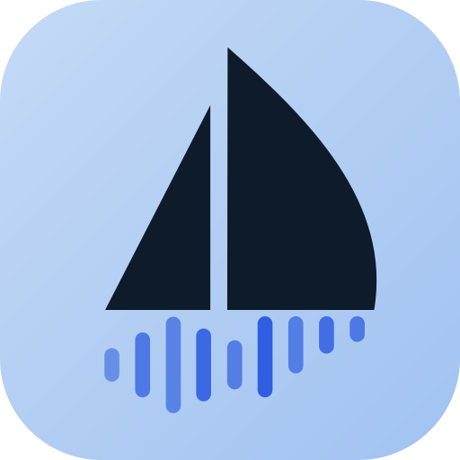
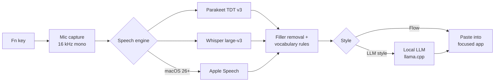

<p align="center">
  
</p>

<h1 align="center">Vela</h1>

<p align="center">
  <b>Private, on-device voice dictation and transcription for macOS.</b><br>
  Press Fn, speak, and your words appear wherever the cursor is. No cloud, no account, no subscription.
</p>

<p align="center">
  
  
  
  
  
</p>

---

## What is Vela?

Vela is a menu-bar app that turns speech into text using models that run entirely on your Mac. It started as a replacement for cloud dictation tools and grew into a small local speech toolkit:

- **Dictation** anywhere: Slack, email, docs, the terminal, a prompt box.
- **Voice Notes**: drop in WhatsApp voice notes or any audio file and get a clean, readable transcript, split by speaker when there's more than one.
- **A local transcription API** that AI agents on the same machine can call to "watch" a YouTube video or Instagram reel by reading its transcript.

Audio never leaves the machine. Models download once from Hugging Face, then everything works offline.

## Features

### Dictation
- **Three speech engines.** Whisper large-v3 (the default, most languages), NVIDIA Parakeet v3 (much faster, 25 European languages) or Apple's on-device engine on macOS 26+.
- **Fn to talk.** Press Fn (or a custom shortcut) to start, press again to stop and paste into the focused app. Esc cancels, Control pauses.
- **Hands-free stop word.** Say "watermelon" to end a take without touching the keyboard.
- **Dictation styles.** *Flow* inserts your words as spoken (minus filler words). *Polished*, *Prompt*, *Compose* and your own custom modes run the text through a local LLM with their own prompt first. Styles can be pinned per app.
- **Bilingual.** Auto-detects English and Spanish per take, or locks to one language.
- **Vocabulary.** Teach it names and jargon ("Konstantin", "Tailscale") and correction rules for words it keeps mishearing.
- **Polite to your Mac.** Pauses music while you talk and resumes it after, ignores silent recordings instead of hallucinating text, and auto-stops after 10 minutes.

### Voice Notes
- Drag in `.ogg`, `.opus`, `.m4a`, `.mp3` or `.wav` files.
- **Speaker detection** splits conversations into "who said what", with renameable speakers. Single-speaker monologues stay as one voice.
- **Readable output.** Long monologues are broken into paragraphs at natural topic shifts.
- **Vocabulary boosting.** A second acoustic pass checks the audio for your vocabulary terms, which catches accent variants a find-and-replace rule would miss.
- Full-text search (⌘F), and one-click "Copy all for Claude" to hand transcripts to an AI.

### Local API for agents
- Loopback-only HTTP server on `127.0.0.1:47821`.
- `POST /transcribe` with a URL (YouTube, Instagram, TikTok, …) or a local file path. Vela downloads the audio with `yt-dlp` and returns the transcript.
- Ships with an **MCP server** and a **Claude Code skill** in [`Integrations/`](Integrations) so agents can use it directly.

## How it works



| Stage | Technology |
|---|---|
| Speech recognition | [Parakeet TDT 0.6B v3](https://huggingface.co/FluidInference/parakeet-tdt-0.6b-v3-coreml) via [FluidAudio](https://github.com/FluidInference/FluidAudio), [Whisper](https://github.com/argmaxinc/WhisperKit) via WhisperKit, or Apple's on-device `SpeechAnalyzer` |
| Speaker diarization | pyannote via SpeakerKit (CoreML) |
| Vocabulary boosting | CTC keyword spotting ([arXiv:2406.07096](https://arxiv.org/abs/2406.07096)) via FluidAudio |
| Text cleanup | Built-in [llama.cpp](https://github.com/ggml-org/llama.cpp) running a small instruct model, with Ollama as an optional fallback |
| Text insertion | Clipboard + synthetic ⌘V through the Accessibility API |

**Memory.** Models load on demand, often while you're still speaking, and are unloaded after an idle period (2 minutes by default). When idle, Vela is just a small menu-bar process.

## Requirements

- macOS 14 or later on Apple Silicon
- Xcode Command Line Tools (full Xcode is not needed)
- About 1–2 GB of disk space for models, downloaded on first use
- Optional: [`yt-dlp`](https://github.com/yt-dlp/yt-dlp) for the URL transcription API (`brew install yt-dlp`)

## Build and install

```bash
git clone https://github.com/Beniharbor/Vela.git
cd Vela
Scripts/package.sh release install   # builds, copies to /Applications, launches
```

`Scripts/package.sh release` without `install` just builds `build/Vela.app`.

> **Tip:** to keep macOS permission grants across rebuilds, create a self-signed code-signing certificate named **Vela Dev** in Keychain Access. The build script uses it automatically and falls back to ad-hoc signing.

## First run

1. Set **System Settings → Keyboard → "Press 🌐 key to"** to **Do Nothing**, so Fn doesn't also open the emoji picker.
2. Grant **Accessibility** when prompted. It's needed for the Fn key and for pasting.
3. Press Fn and say something. The first take downloads the speech model, and macOS asks for **Microphone** access.
4. Press Fn again. The text appears in the focused app.

## Using the API

```bash
# Is Vela running?
curl http://127.0.0.1:47821/health

# Transcribe a video
curl -X POST http://127.0.0.1:47821/transcribe \
  -H 'Content-Type: application/json' \
  -d '{"url": "https://www.youtube.com/watch?v=..."}'
```

Add `"async": true` to get a job id back immediately and poll `GET /transcribe/<id>`, which is handy for long videos. For MCP clients, register [`Integrations/mcp/vela_mcp.py`](Integrations/mcp/vela_mcp.py), which has no dependencies beyond Python 3.9.

## Project layout

```
Sources/Vela/
  VelaApp.swift               App entry, menu bar, dashboard window
  DictationController.swift   Recording → transcription → cleanup → paste
  Transcriber.swift           WhisperKit engine
  ParakeetTranscriber.swift   Parakeet engine + vocabulary boosting
  AppleSpeechTranscriber.swift
  SpeakerDiarizer.swift       Who-said-what for Voice Notes
  Paragraphs.swift            Monologue → readable paragraphs
  LocalLLM.swift              Built-in llama.cpp runtime
  LocalAPIServer.swift        127.0.0.1:47821 transcription API
  VoiceNotesStore.swift       Voice Notes import pipeline + storage
  DashboardView.swift         History, Voice Notes, Modes, Settings UI
Integrations/                 MCP server and Claude Code skill
Scripts/package.sh            SPM build → signed Vela.app bundle
```

## Privacy

Vela makes network requests only to download models from Hugging Face, and, if you use the URL API, to fetch the media you asked for. Transcripts, history and voice notes are stored as JSON in `~/Library/Application Support/Vela/` and never uploaded.

## Acknowledgements

Built on [WhisperKit](https://github.com/argmaxinc/WhisperKit) by Argmax, [FluidAudio](https://github.com/FluidInference/FluidAudio) by Fluid Inference, [llama.cpp](https://github.com/ggml-org/llama.cpp), and [KeyboardShortcuts](https://github.com/sindresorhus/KeyboardShortcuts) by Sindre Sorhus.

## License

[MIT](LICENSE)
